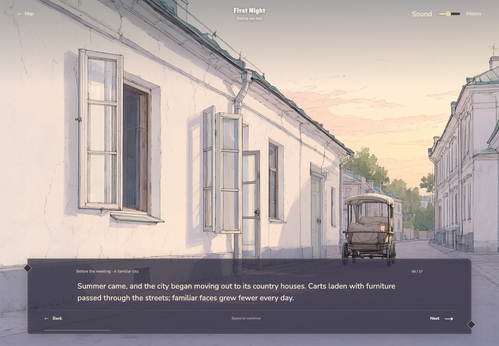
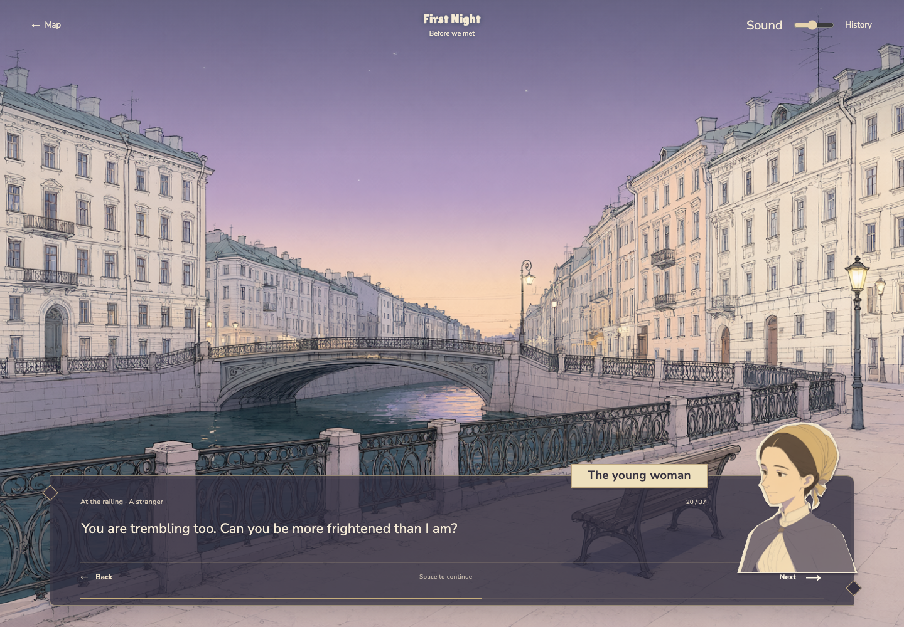
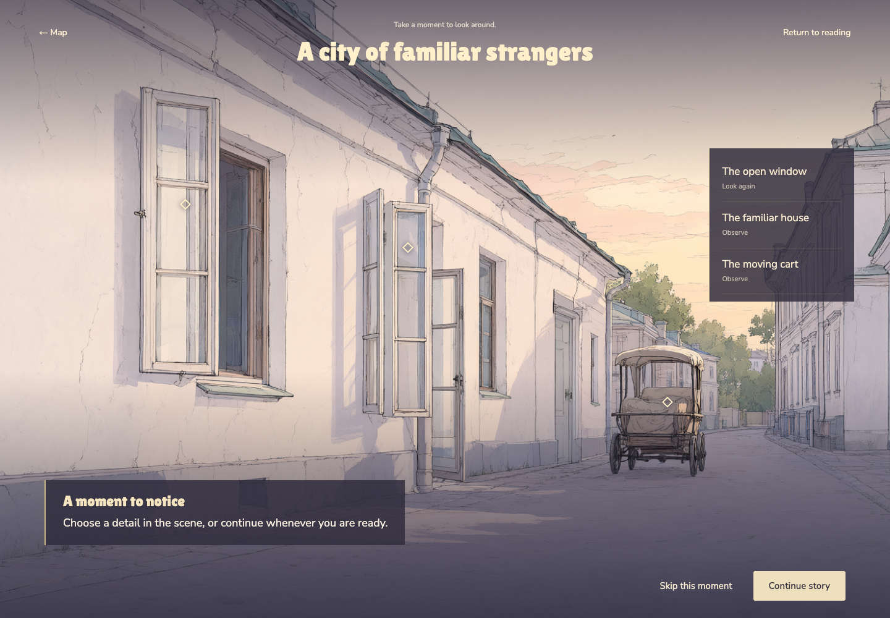
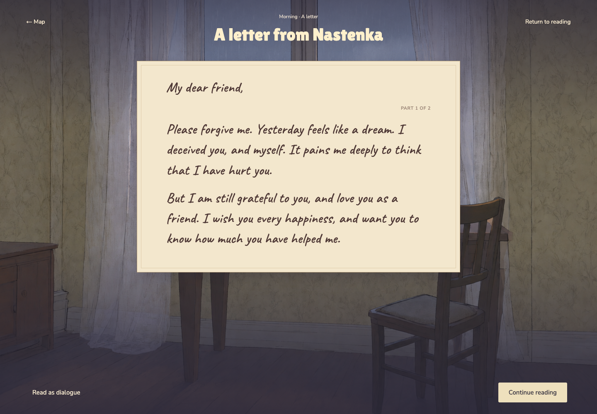
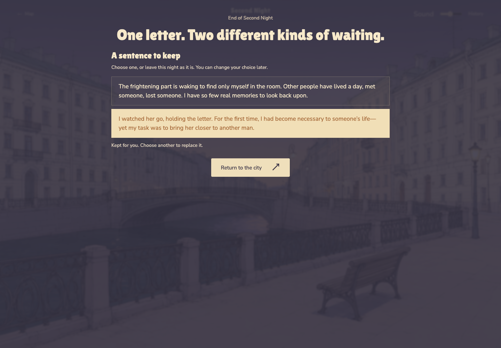

# White Nights

An English interactive narrative after Fyodor Dostoevsky’s *White Nights*. Explore an illustrated Petersburg canal, follow the dreamer through four nights and a morning, and read at your own pace. The ending follows the novel; exploration and reading pace belong to the reader.





## Who it is for

Readers who enjoy literature and visual novels, including people unfamiliar with the original. The story starts with the dreamer’s solitary life before his first meeting. There are 152 adapted paragraphs across five chapters, approximately 3,729 English words. This is an abridged adaptation, not a verbatim edition.

## Main interaction

1. **Explore the city:** focus the city canvas and hold the arrow keys (↑ ↓ ← →) to walk relative to the current camera along the embankment and over either bridge. A nearby place lights up; press Enter to explore it. Drag to turn the view within a limited angle; scroll to zoom. Hover or focus a location to reveal its name. `Places` offers a location directory; `Reset view` restores the camera.
2. **Begin a chapter:** select `Begin First Night`. The dreamer walks from the current map position to the chapter’s place before the reader opens. `Skip transition` skips this journey. Reduced-motion preferences bypass camera transitions and disable continuous ambient animation.
3. **Read:** use `Next`, Space or Right Arrow. While text is appearing, the first action reveals the rest; the next advances. `Back` or Left Arrow returns to the previous paragraph. The dialogue frame sizes to the complete paragraph before typing begins, then stays stable during the reveal. Short passages use less space; very long passages scroll inside the frame. Text is selectable. Narration uses a wide reading area; dialogue places the speaker’s portrait at the appropriate side.
4. **Resume:** `History` shows the current chapter’s read paragraphs. `Map` returns to the city. Progress is saved in this browser, with independent reading positions for unlocked chapters.
5. **Sound and reset:** sound is off initially. Use the music button on either screen; the reader includes volume control. `Restart story` is on the homepage and asks before clearing reading progress, interaction state, map position and keepsakes; the Intro appears again. The same action is in `About`.

## PC interaction edition

This iteration targets desktop keyboard and mouse. First-time readers see an English Intro; existing readers return directly to their saved map. Replay the introduction from About.

- **Walk and meet:** click the canvas to give it keyboard focus. Use arrows (not WASD), Enter to inspect a nearby place, then confirm the chapter entry. Proximity only highlights; it never starts reading automatically. Begin/Continue also offers an automatic journey and Skip transition.
- **Notice the city:** after the opening paragraph, inspect a window, a house and a moving cart in any order. The object list is keyboard accessible. Continue or skip whenever you wish.
- **Accept the letter:** near the end of Second Night, take the sealed envelope or skip the gesture. Delivery remains part of the next chapter’s existing narration.
- **Wait:** Third Night offers the bridge, water and street as optional observations. There is no timer or correct choice.
- **Turn toward footsteps:** Fourth Night offers a distant figure or a text button. Looking gently reframes the scene; Continue returns to the fixed story.
- **Read the morning letter:** open the period-style envelope with a short animation and read the handwritten paper, return to the dreamer’s reaction, then read the remainder. Read as dialogue keeps the original paragraph-by-paragraph presentation.
- **Pause or revisit:** Return to reading / Escape pauses an interaction; Map suspends it. Continue restores unfinished interaction state, even after reload. Back to an event’s anchor exposes Replay this moment; completed moments do not block ordinary rereading. History retains exposed letter text.
- **Keep a memory:** at each chapter end, optionally keep one of two original passages. Replace it later in Your memories. Uncollected chapters have no empty slots or completion score. Places also gain descriptions as chapters end; New memory clears after reading.





Implementation and verification decisions: [PC iteration ledger](docs/implementation/pc-interaction-ledger.md).

## Run in VS Code

Use Node.js 22.12+ (or Vite-compatible Node 20.19+) and a modern browser. Tested with Node 26.2.0, npm 11 and Google Chrome. Open this folder in VS Code and run:

```sh
npm ci
npm run dev
```

Open the URL printed in the terminal, normally `http://127.0.0.1:5173/`. Stop with Ctrl+C. Do not open `index.html` directly.

Only dependency installation requires a network connection. Reading requires no API key, paid account, Python or AI service. Scene illustrations, both portraits, and Nunito Sans, Lilita One and Caveat fonts are bundled. WebGL 2 renders the city; if unavailable, the location directory and reading remain available.

For a production preview:

```sh
npm run build
npm run preview
```

The static output is in `dist/`, with relative asset paths suitable for a GitHub Pages subdirectory. No public live experience has been published yet.

## Verification

```sh
npm test
npm run build
npm run test:e2e
```

Browser tests use installed Google Chrome and start or reuse the local development server. They cover all five chapters, English-only content, walking and place proximity, restart confirmation, save restoration, touch use, portraits, small-screen layouts, actual audio output, failure feedback, camera transitions and interrupted dialogs. Legacy screenshots are written to ignored `test-results/`; PC interaction captures are in `docs/screenshots/pc-*.png`. New checks cover observation/letter recovery, replay, optional full-story traversal, keepsakes, image failure and PC layouts. The 200% layout check uses a 640×360 CSS viewport, equivalent to the layout space of 1280×720 at 200% zoom; browser toolbar zoom itself is not automated.

Automated checks and AI reviews do not replace the assignment’s independent human trial. That trial remains to be completed in [PROCESS.md](PROCESS.md).

## Project structure

| File | Purpose |
| --- | --- |
| `src/story-text.js`, `src/content.js` | English prose, speaker names, chapter metadata and locations |
| `src/story.js`, `src/main.js` | Validated saves, progress state, focus and interface behavior |
| `src/interactions.js`, `src/interaction-view.js`, `src/interaction-stage.css` | Stable event anchors, optional scene interfaces and PC layouts |
| `src/map.js`, `src/walking.js`, `src/scene-art.js` | City geometry, walkable route, miniature character, materials, camera and picking |
| `src/style.css`, `src/home.css`, `index.html` | Reading and city layouts |
| `src/music.js` | Original melody and bass synthesized with Web Audio |
| `public/assets/`, `tools/generate_assets.py` | Bundled illustrations, prompt records and optional generation tool |

An interaction to explain in class: arrow keys move the dreamer along the bank or bridge; entering a place’s proximity highlights it, and Enter opens its description. Starting a chapter dispatches `START`; `map.travel()` follows the paved route; `ARRIVE` opens the saved paragraph. Stable paragraph IDs preserve all 152 paragraph positions, so existing saves remain valid. Event completion and its resume paragraph update in a single reducer action.

## Optional illustration generation

This is a browser project. The optional generator uses only Python’s standard library, with no additional Python dependencies. Existing assets are preserved. Place the classroom credential in an external `.env` file as `EASEL_KEY=...`, then run:

```sh
uv run --no-project --python 3.12 tools/generate_assets.py --env /absolute/path/to/classroom/.env
```

The classroom Easel / Qwen Image API may consume classroom credits. Add `--only dreamer-portrait nastenka-portrait summer-street rainy-embankment` to select assets. Credentials never enter browser code or asset metadata; prompt records are stored beside the generated images. The city and miniature character use procedural geometry, not this API.

## Limitations

- The city and routes are literary interpretations, not historical reconstructions. Walking stays on the canal pavements and two bridges; other streets are scenery.
- Portraits have fixed expressions; some scenes share illustrations.
- Saves are local to the current browser. Storage failures show feedback without blocking reading.
- This iteration targets PC. Phone performance, other browsers and an independent human trial remain unverified.
- The Three.js build chunk produces a size warning; it does not prevent building.

[Process](PROCESS.md) · [Credits](CREDITS.md) · [Repository](https://github.com/LingLiu0305/White-nights)
