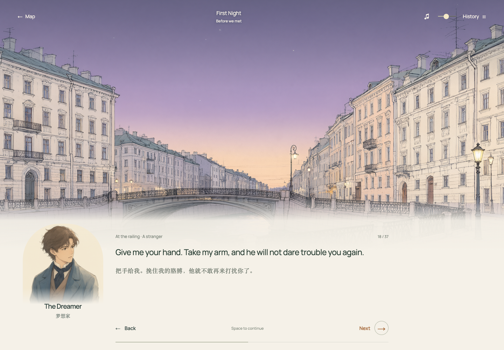
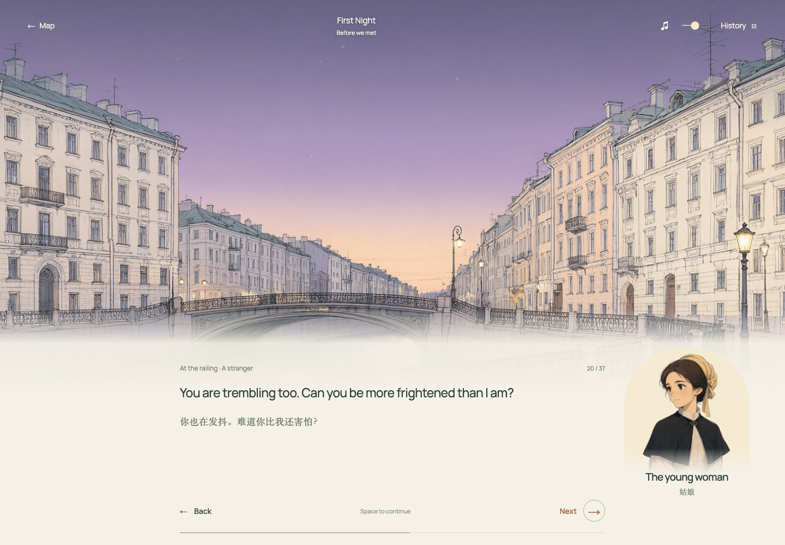

# 白夜 · White Nights

一部以英文为主、保留中文对照的网页交互叙事，改编自陀思妥耶夫斯基《白夜》。探索微缩彼得堡，跟随梦想家的标记走入四个夜晚，在场景插画、角色肖像和文字之间经历相遇、等待与告别。

A bilingual narrative website after Dostoevsky’s *White Nights*. Explore a miniature Petersburg, follow the dreamer to each meeting, and read the story in paired Chinese and English. The ending follows the novel; the reader controls exploration and pacing.





## 体验与目标读者

面向喜欢文学、视觉小说和短篇故事的读者，无需预先读过小说。现在从第一夜相遇之前的城市与独居生活开始，补足倾诉、送信和等待的因果关系。当前版本为 **152 段扩写改编**，包含四夜及清晨尾声；约 25–35 分钟，双语细读时间会更长。它不是小说全文，也不是任何已出版中译本的逐字引用。

1. **探索地图：**拖动旋转、滚动缩放；点击建筑标签、相关建筑或 `Places` 中的按钮，查看双语介绍。`Reset view` 恢复视角。
2. **走进一夜：**点击 `Begin First Night`，金色标记沿示意路线移动；`Skip transition` 可跳过过场。到达后进入二维阅读画面。
3. **控制阅读：**点击 `Next`，或在阅读区域按空格 / 右方向键。逐字显示时，第一次操作补全两种语言，下一次推进故事。`Back` 或左方向键可以返回。英文主文在上，中文对照在下；正文可选择和复制，双击不会翻页。
4. **回来继续：**`History` 保留本章已读文字；`Map` 返回地图。刷新或关页后可从本机保存位置继续。已读章节可以重读，各章进度独立保存。
5. **重新开始：**地图页 `About the story` → `Start again` → 确认。音乐默认关闭，可在地图页或阅读页播放 / 暂停；阅读页右上角可以调节音量。

## 在 VS Code 运行

需要 Node.js **22.12+**（或符合 Vite 7 要求的 Node 20.19+），以及现代浏览器。实际验证环境为 Node 26.2.0、npm 11、桌面 Chrome。推荐使用支持 WebGL 2 的浏览器；无法显示 3D 时仍可通过文字地点入口阅读。

用 VS Code 打开项目目录，在该目录的终端执行：

```sh
npm ci
npm run dev
```

打开终端显示的地址，默认是 **http://127.0.0.1:5173/**。按 `Ctrl+C` 停止。不要直接双击 `index.html`，本项目需要开发服务器处理模块导入。

第一次安装依赖需要网络。**读故事不需要 API key、付费账号、Python 或在线 AI 服务**；四张场景插画和两张人物肖像已包含在仓库中。英文 Manrope 字体随应用打包，不依赖在线字体服务；中文使用系统宋体类字体。

生产版本：

```sh
npm run build
npm run preview
```

打开终端显示的预览地址，默认 **http://127.0.0.1:4173/**。静态成品位于 `dist/`，使用相对资源路径，适合部署在 GitHub Pages 子目录。当前尚未发布公开体验链接。

## 检查

```sh
npm test
npm run build
npm run test:e2e
```

单元测试检查章节解锁、进度恢复、旧存档迁移、重读、损坏 / 不可用的存储及双语内容完整性。浏览器测试检查完整五章、桌面与手机尺寸、键盘、逐字显示、历史记录、文字选择、上一段、实际音频信号与播放失败，以及 WebGL、背景图片和存储失败后的阅读。

浏览器测试配置使用**已安装的 Google Chrome**，会自动启动开发服务器，或使用已经运行的 5173 端口。测试阻断外部字体服务，检查应用不依赖第三方字体网络；截图写入忽略提交的 `test-results/`。也验证人物左右切换、肖像与文字不重叠、肖像缺失仍可阅读，以及 568 × 320 小屏横向布局。自动测试不能替代真人试读；记录待填写，见 [PROCESS.md](PROCESS.md)。

## 项目结构

| 文件 | 内容 |
| --- | --- |
| `src/story-text.js`、`src/content.js`、`src/content-en.js` | 按场景配对的中英正文、说话人、场景插画与章节地点 |
| `src/story.js`、`src/main.js` | 状态转换、各章进度，以及按钮与画面的连接 |
| `src/map.js` | Three.js 建筑、卡通材质、拾取、视角和标记移动 |
| `src/style.css`、`index.html` | 地图页面、双语阅读与手机布局 |
| `public/assets/`、`tools/generate_assets.py` | 已生成插画、提示词记录及可选生成工具 |

两种语言按章节及段落一一对应；修改正文时，在 `src/story-text.js` 同时编辑同一行的中英文，再运行 `npm test`。背景音乐的旋律与伴奏位于 `src/music.js`。可用于课堂解释的交互链：`start-story` 点击 → `START` 转换状态 → `map.travel()` 移动标记 → `ARRIVE` → 显示本章中英文字。

## 素材生成（可选）

此项目是浏览器项目；只有可选的生成工具使用 Python 标准库，**没有额外 Python 依赖**。已有插画不会重复生成。

若需要生成缺失素材，将课堂凭据放在仓库外的 `.env` 文件中，格式为 `EASEL_KEY=你的凭据`。安装 `uv` 后运行：

```sh
uv run --no-project --python 3.12 tools/generate_assets.py --env /absolute/path/to/classroom/.env
```

工具调用课堂 Easel 接口的 `qwen-image-2.1`，可能消耗课堂额度。它仅在开发阶段运行，凭据不进入网页或素材元数据。完整提示词、尺寸和生成日期记录于图片旁的 JSON 文件。

可添加 `--only dreamer-portrait nastenka-portrait summer-street rainy-embankment` 指定素材；工具保留已存在的文件。

## 扩写版与旧进度

初版的段落编号已不适用于新文本。首次打开扩写版时，已解锁章节会保留，阅读位置回到新的开头，并显示更新提示；之后按新版段落正常保存。

首页采用大幅英文标题、放大的中央模型和边缘操作，删去坐标、标语等装饰性信息。过场时收起首页文字。阅读页采用同一套无衬线英文与纸色色调；梦想家说话时肖像和姓名在左侧，姑娘 / 娜斯坚卡在右侧，旁白和内心独白收起肖像。首次得知姓名前仍称为 “The young woman”。

## 当前边界

- 地图是文学空间示意，不复原真实路线；多个夜晚在同一河岸会面。标记移动后淡入插画，当前不做电影式镜头跟随。
- 两张人物肖像是固定表情的插画，不是动画立绘；雨景、街景、河岸和房间随段落切换，部分场景仍共用插画。
- 固定结局和精简对白属于设计选择；中英文均为项目改编，仍欢迎对照原著进一步审校。
- 进度只保存在当前浏览器，不跨设备同步。无存储权限时会显示提示，仍可完成当前阅读。
- 已检查 Chrome 桌面及手机尺寸模拟，尚未在真实手机及所有浏览器上测试，也尚未完成真人试读。

创作与试读：[PROCESS.md](PROCESS.md) · 来源：[CREDITS.md](CREDITS.md) · 仓库：[LingLiu0305/White-nights](https://github.com/LingLiu0305/White-nights)
