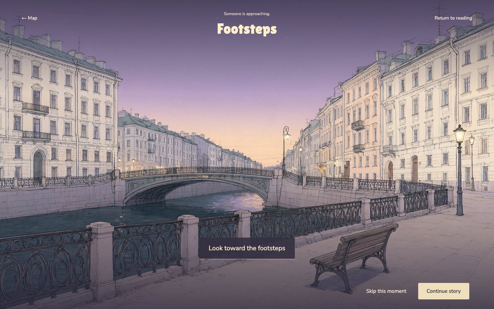
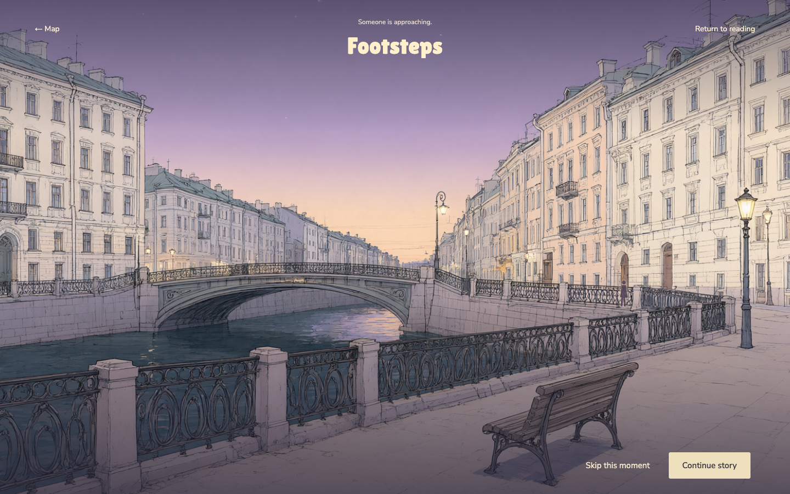
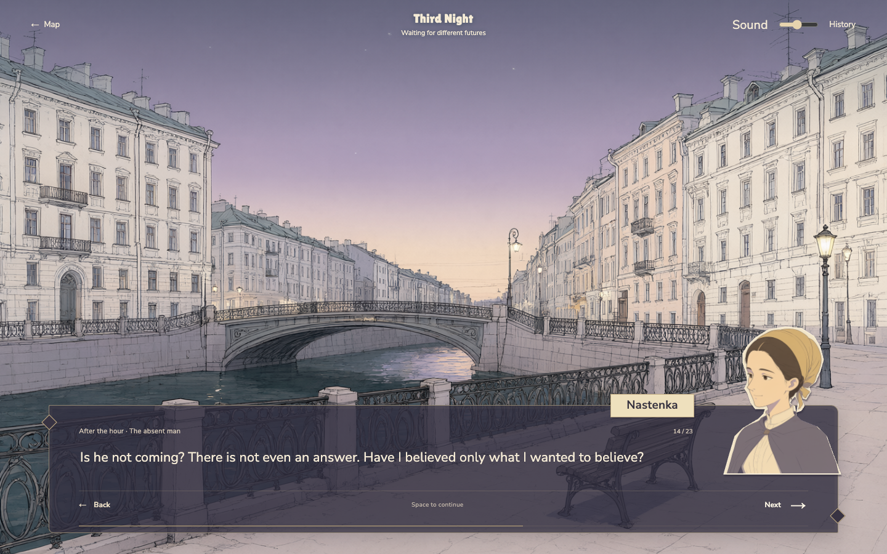
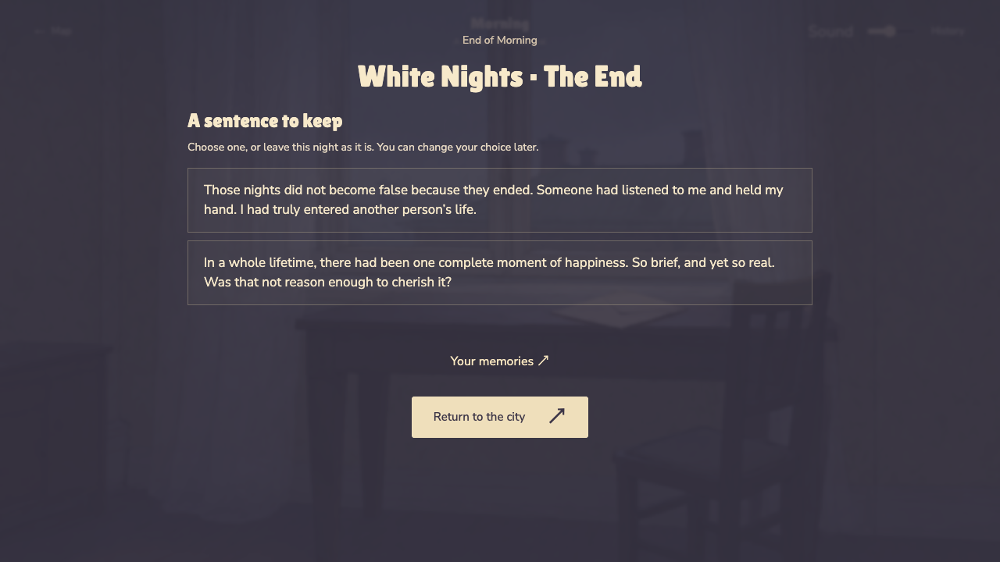
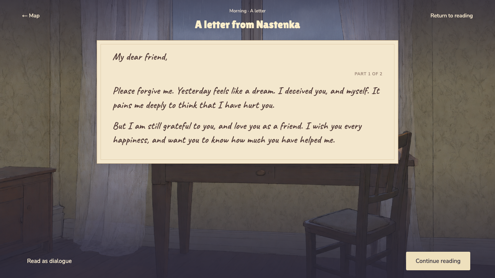

# WHITE NIGHTS — Narrative playthrough review

Date: 29 October 2026 (Hong Kong). Reviewed revision: `531980f`.

## Scope and method

This is an AI-assisted design review, not the independent human user trial required by the assignment. No game code, story text, assets or existing user saves were changed for this review.

A separate Chrome session started with a fresh save at `http://127.0.0.1:5173/`. The reviewer advanced through all five chapters using the rendered interface, without injecting completed chapters or paragraph cursors. Normal typewriter animation remained enabled. The main viewport was 1440×900; morning reading was also checked at 1280×720. Browser actions were automated with Playwright and screenshots were inspected visually; this does not establish human reading speed or emotional response.

Checked: Intro, arrow-key walking near home, Enter/place introduction, automatic chapter travel, opening observations, pause/resume, both memory illustrations, one listening choice and its History entry, letter handoff, optional waiting and skipping, footsteps, both morning letter sections with the intervening reaction, reload while reading the letter, chapter endings, optional keepsakes, and revisiting chapter lighting. Volume-slider arrow input did not advance the story. Audio quality was not assessed by listening.

## Previous recommendations retained

These remain a backlog, not an implementation commitment. The playthrough refinements below take precedence where they narrow a recommendation.

| ID | Original recommendation | Proposed direction |
| --- | --- | --- |
| R01 | Connect interactions more closely to dialogue | Present listening choices within the conversation, retaining the character and setting. Reserve full-screen transitions for real changes of scene. |
| R02 | Strengthen Fourth Night's Footsteps | Make the distant figure, change of attention and return to trembling-hand dialogue perceptible. Preserve the fixed ending and optional skip. |
| R03 | Clarify Third Night's retrospective structure | Distinguish today's rain, the previous evening, and the return to today through transitions. |
| R04 | Clarify the imagined future and preserve ending space | Replace “Fifteen years later” with “A future imagined”; allow the final scene to settle before offering keepsakes. |
| R05 | Reconsider opening observation timing | Let exploration follow the houses-as-acquaintances passage or reduce repetition between observations and subsequent background paragraphs. |
| R06 | Reduce out-of-story instructions | Move “The story and its ending remain the same” to About; use short contextual prompts within scenes. |
| R07 | Give observations meaningful feedback | Add restrained local emphasis or framing; descriptions should reveal emotion rather than restate the object name or previous paragraph. |
| R08 | Offer reading preferences | Text speed, instant text, font size and an optional print-font letter view. Preserve the first-click-reveals / next-click-advances contract. |
| R09 | Clarify pause, skip and completion controls | Distinguish temporary return from skipping and finishing; remove obsolete skip controls after the action has happened. |
| R10 | Vary chapter endings | Keep sentence collection optional and quieter, particularly after Fourth Night and Morning. |
| R11 | Connect map and illustration atmosphere | Carry chapter-specific light and colour into reused canal scenes without making text hard to read. |

## Findings from the actual playthrough

### 1. P1 — Footsteps works, but its completion is visually weak

**Observed:** “Look toward the footsteps” enlarges the scene. The distant figure remains small against detailed railings; the title and hint remain unchanged. “Skip this moment” remains alongside “Continue story” after looking. Both before and after states are captured below.

**Recommendation:** Keep the interaction in the conversation's visual language. Direct attention to the approaching figure with a short camera move and a restrained contrast change. After looking, hide the obsolete skip/action controls and return naturally to the existing paragraph about her trembling hand. Do not add a new plot choice or require a timed action.

### 2. P1 — Listening choices interrupt the conversation's presentation

**Observed:** The listening interaction replaces the portrait/dialogue layout with a large headline, two central options, an explanatory response panel and a distant Continue button. Choosing “Ask about her childhood” produces a distinct response, and History retains it correctly.

**Recommendation:** Retain Nastenka and the existing dialogue scene; display choices beside or above the dialogue panel, then place the selected response in that panel. Keep the optional nature of the choice, but put fixed-ending explanations in About.

### 3. P1 — Character expression does not follow emotional changes

**Observed:** Third Night paragraph 14 (“Is he not coming? There is not even an answer…”) uses the same calm, slightly smiling Nastenka portrait as lighter conversation.

**Recommendation:** Preserve the approved face, outfit and illustration style. Add only a few consistent expressions: attentive, hopeful and distressed. Switch them at meaningful beats rather than every line. Prioritise this over new interaction types.

### 4. P2 — Initial map exploration needs a clearer relationship to starting the story

**Observed:** After Intro, the player begins near the little room. Enter opens its introduction, which has no First Night start action. Closing it and using Begin First Night works. Walking itself responds and the proximity prompt is visible.

**Recommendation:** Explain the distinction once: “Explore the city, or begin the first night.” Give the current chapter's destination a distinct marker and label automatic travel explicitly where useful. Do not force first-time readers to navigate the whole city.

### 5. P2 — An observation remembers being seen but not the currently displayed object

**Reproduction:** Third Night waiting → choose The water → Return to reading → Resume this moment.

**Observed:** The water remains marked “Look again”, but the response panel returns to “A moment to notice / Choose a detail…”. Progress is retained, but the reading context is lost.

**Recommendation:** Retain and restore the last selected object and its text. Keep the existing saved seen-object list and do not advance the story on resume.

### 6. P2 — Newly unlocked place memories are easy to overlook

**Observed:** After First Night, “New memory” is visible inside Places. A reader taking the prominent next-chapter route can miss these updates.

**Recommendation:** Use one subdued reminder at an affected map location or next to Places. Avoid scores, collection percentages or recurring notifications.

### 7. P2 — Keep the existing time cues, improve their hierarchy

**Observed:** Third Night already labels “Remembering yesterday”, “Yesterday, before ten”, and “Back to today”, with a rainy-room opening and rainy riverbank return. It is not missing time explanations. The labels are secondary and easy to overlook during fast progression.

**Revision to R03:** Add one brief transition cue or stronger scene-change treatment; a rewrite of the chapter is unnecessary. Separately, Morning's “Fifteen years later” heading still risks implying an actual time jump although the body explicitly calls it an imagined future.

### 8. P2 — Chapter endings introduce collection UI immediately

**Observed:** Fourth Night's final paragraph leads directly to a large ending title and two sentence choices. Morning follows the same pattern. Skipping keepsakes works, and only saved chapters appear in Your memories.

**Recommendation:** Preserve a player-controlled quiet ending state before revealing optional keepsakes. Do not enforce a long wait or turn collection into a completion requirement.

## Working behaviour to preserve

- The inspected left and right portraits clear Back and Next at 1440×900.
- Both the second-night handoff and morning opening show the wax-seal envelope.
- Opening the morning envelope reveals handwritten text. The first section returns to paragraph 5's inner reaction; the second returns to paragraph 7. Reloading the open first section restores the paper.
- At 1280×720, the first letter section fits its container (client height and scroll height both 317 px in this run); no truncation was observed in either section. This is not proof for arbitrary zoom levels or longer replacement text.
- Opening observations, listening choice, two memories, waiting, footsteps and five chapter endings all remained traversable in the tested route.
- One chosen response appears in History, as does a revisit entry for the opened memory.
- First Night / Fourth Night / Morning map screenshots taken after transitions show the intended darker fourth night and brighter morning. No need to rebuild this feature; refine consistency with illustration scenes.
- Browser console reported no errors during the playthrough. It reported the Three.js `PCFSoftShadowMap` deprecation warning.

## Suggested next iteration

1. Strengthen Footsteps and simplify its completed state.
2. Integrate listening choices into the dialogue composition.
3. Add a small, consistent set of character expressions.
4. Restore observation context and improve discovery of place memories.
5. Polish time cues and the ending before expanding the feature set.

Keep the original ending, PC controls and optional interactions. A future human playtest should observe whether a new reader understands the initial map options, the Third Night timeline and Footsteps feedback without prior explanation. This review does not replace that trial.

## Verification before publication

- `npm test`: 35 passed, 0 failed.
- `npm run build`: passed; existing Three.js chunk-size warning remains.
- `npm run test:e2e`: 48 passed (3.7 minutes). This automated regression run is separate from the normal-motion playthrough above.
