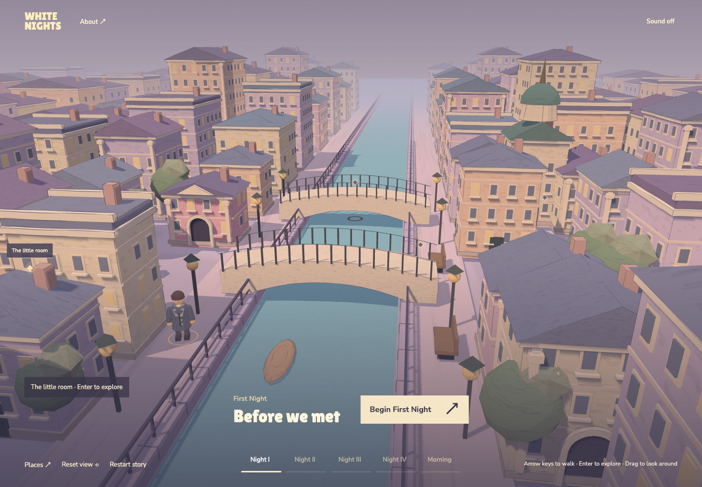
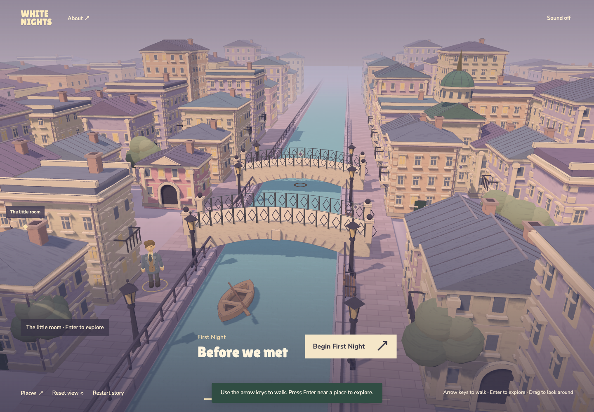
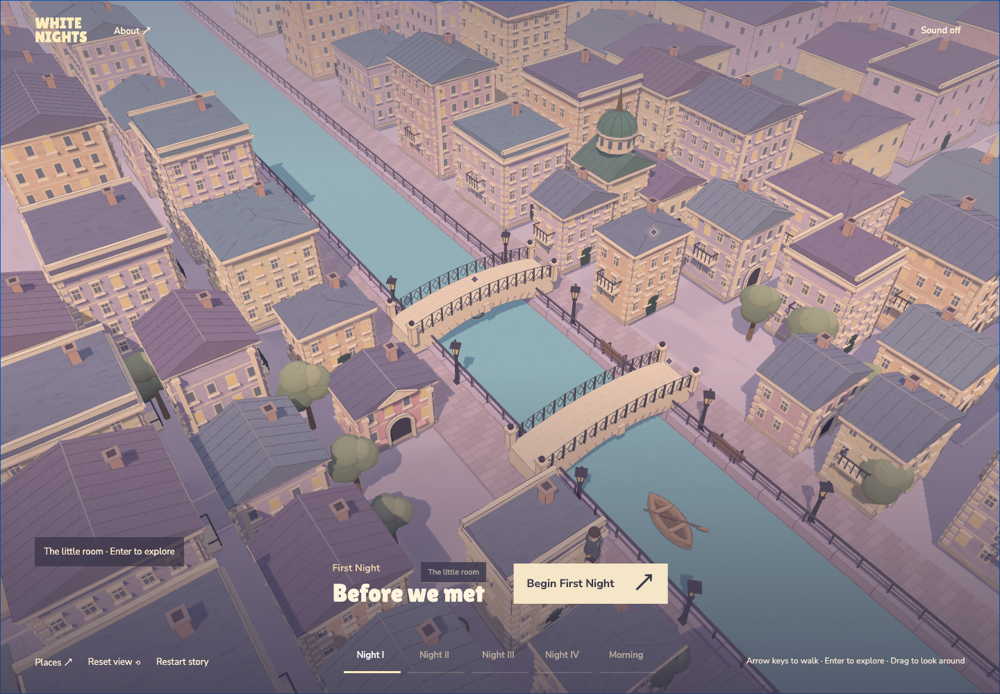
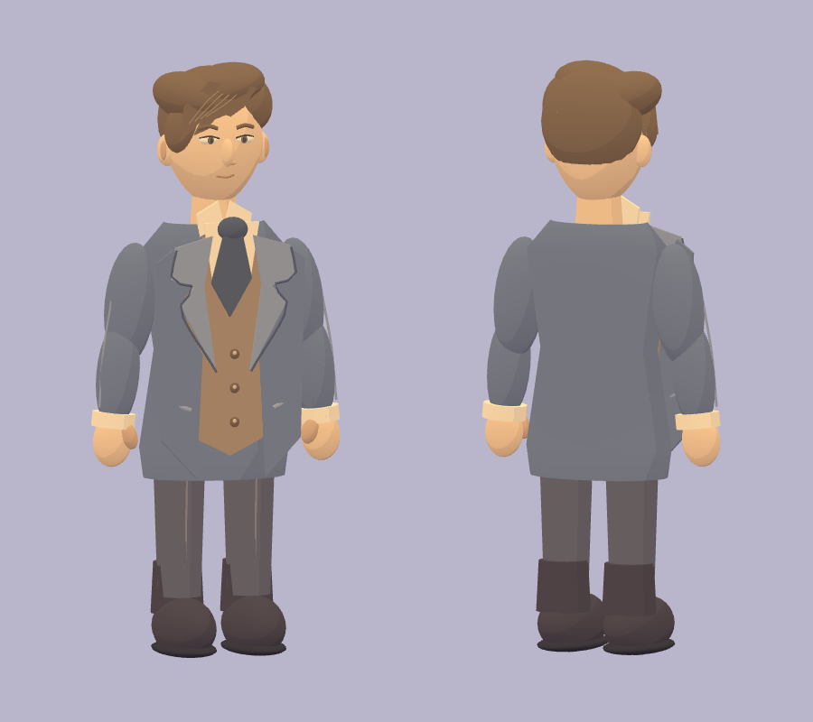

# City and dreamer model refinement

## Direction

The author requested a more detailed home-page city, then asked that its walking figure match the existing Dreamer portrait. Keep the lavender/cream toon palette, story destinations, chapter lighting, readable map and established narrative artwork. This is a stylized literary city, not a claim of historical reconstruction.

## Implemented

- Near buildings: window mullions and transoms, lintels, layered cornices, corner stones, canal-facing balconies, drainpipes, chimney caps and roof seams. Distant buildings retain their lighter geometry.
- Bridges: diamond ironwork, stone-joint accents, keystone and capped end posts; existing bridge deck and navigation coordinates remain unchanged.
- Waterfront: repeating stone paving, framed lanterns, slatted benches, open boat hull with seats and an oar. Furniture was moved to the river edge to clear the walking lane.
- Skyline and planting: rotunda drum windows and dome ribs; overlapping asymmetrical foliage clusters.
- Dreamer: swept brown hair, visible facial features, shaped jaw, open grey-blue coat, warm waistcoat, shirt collar, dark cravat, cuffs, thumbs and rounded boots. The existing illustrated portrait remains unchanged.
- Walking: restrained opposite arm/leg motion during manual and automatic travel. Stopping returns to a neutral pose; reduced motion disables the gait. Animation does not move the navigation root.

The city ornaments use the existing shared toon materials and static geometry batching. The avatar is a separate small articulated model, using shared materials and sphere geometry. No new package, image API, external model or runtime asset download is needed.

## Visual review

Before:

After, including the revised avatar:

Oblique city inspection, captured before the avatar replacement:

Front and rear views of the same revised model, rendered separately for inspection:

## Verification

- Unit suite: 37 tests passed, including gait isolation, stopping and reduced-motion restoration.
- Production build passed; existing Three.js chunk-size warning remains.
- Full city-plus-avatar browser regression: 48 tests passed, including manual walking, automatic travel, old saves, all five chapters and chapter palette changes.
- Inspected the default and rotated city views and the avatar's front/rear render. Existing save progress and story text are not modified.
- This is automated/AI-assisted inspection, not an independent human playtest.
