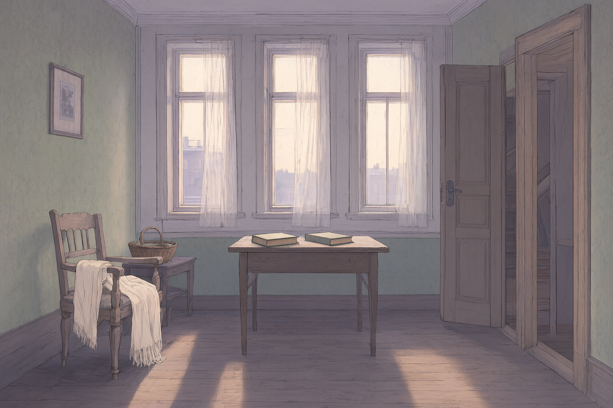
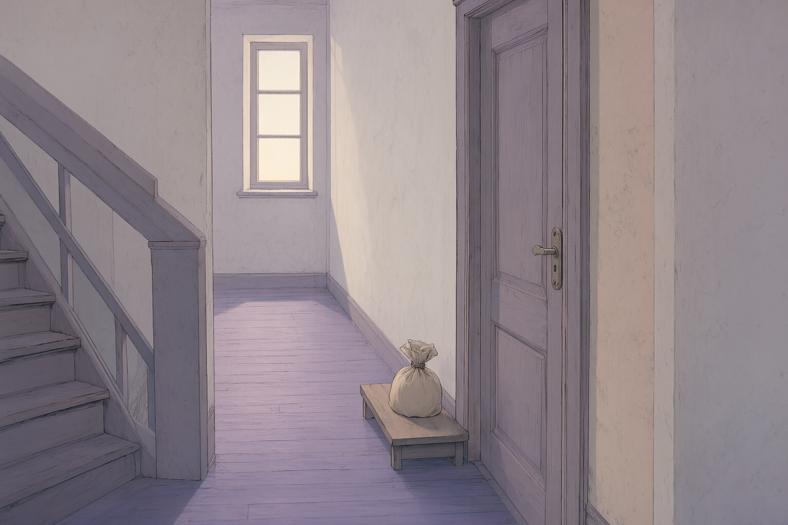

# WHITE NIGHTS — 叙事交互迭代方案

- 日期：2026-10-27（更新）
- 状态：交互设计提案，尚未实现；两张回忆插图已单独生成，尚未接入游戏。本文明确区分已有能力、拟议规则与已准备素材。
- 适用版本：当前五章英文故事、城市地图、左右人物立绘、打字机阅读系统。
- 文档语言：中文；所有拟新增的玩家可见文案使用英文。
- 平台范围：本轮仅 PC 浏览器，键盘与鼠标；不安排手机、触屏或竖屏适配。保留已有响应式代码，不为本轮主动拆除。
- 设计目标：让玩家通过观察、赴约、倾听、等待与读信参与故事，保留原著结局。

快速定位：[英文 Intro](#19-新增英文开场-introp1) · [PC 行走技术细则](#20-pc-方向键行走与剧情触发技术细则) · [已生成素材](#21-素材清单生成记录与接入约定)

## 1. 现有流程与改动边界

当前主流程：

`地图选择章节 → Begin / Continue → 路径过场 → 逐段阅读 → 章节结束 → 返回地图 → 下一章`

已具备的交互：方向键行走、靠近地点高亮并按 Enter 探索、地点介绍、镜头拖拽、恢复视角、音乐开关与音量、打字机文字、前后翻段、历史记录、章节解锁、本地存档、重新开始。

目前最大的拓展空间是：地图行动与故事的衔接、长段阅读中的节奏变化，以及信件、等待等关键情节的专属操作。保留现有美术、字号和阅读框体系，不重新设计全站。

### 设计原则

1. 每章最多安排一个主要交互事件；其余互动保持可选、轻量。
2. 不加入好感度、得分、错误结局、倒计时选择或必须集齐的物件。
3. 操作可以影响观察顺序、表达方式和阅读节奏，不承诺改变剧情结局。
4. 不要求真实等待，不以快速反应、精确拖拽或声音辨认作为通关条件。
5. 所有主线内容都应可通过明确按钮阅读；探索失败、WebGL 不可用或音效失败不得阻断故事。
6. 已有阅读进度继续有效；新增互动不能导致老存档突然跳段或丢失章节。

## 2. 优先级与分期

| ID | 交互 | 优先级 | 建议阶段 | 相对工作量 |
|---|---|---|---|---|
| INTRO | 英文来源介绍与进入世界 | P1 | 第一轮入口 | 低 |
| INT-01 | 开场物件观察 | P1 | 第一轮 | 中 |
| INT-02 | 清晨拆信与读信 | P1 | 第一轮 | 低—中 |
| INT-03 | 主动走到章节地点 | P1 | 第一轮基础设施 | 中 |
| INT-04 | 等待中的注意力选择 | P1 | 第一轮 | 中 |
| INT-05 | 接过与托付信件 | P2 | 第二轮 | 中 |
| INT-06 | 表达方式选择 | P3 | 试验后决定 | 中—高，主要成本在文案 |
| INT-07 | 主动展开回忆插画 | P3 | 试验后决定 | 中—高，需新素材 |
| INT-08 | 第四夜的视线转移 | P2 | 第二轮 | 中 |
| INT-09 | 随经历变化的地点 | P1 | 第一轮 | 低—中 |
| INT-10 | 保留一句纪念句 | P2 | 第二轮 | 低—中 |

第一轮建议顺序：Intro → INT-03 行走与赴约 → INT-01 → INT-02 → INT-04 → INT-09。先建立通用互动容器和恢复规则，再复用。不要同时实现全部十项。

## 3. Trigger 约定

本文段落编号为当前 UI 显示的一基编号，代码 `state.line` 为零基。编号仅帮助定位，**不能成为长期运行的硬编码触发器**。实现时为关键段落增加稳定 `id`，与独立交互配置关联；文字修改或增段后保留原有 ID。

下文的 `beforeAdvance` 定义为：

1. 玩家点击 Next / 按阅读快捷键。
2. 若当前文字正在打字，先补全文字；本次输入不触发事件。
3. 若文字已完整，检查当前段落后是否有尚未处理的互动。
4. 有则打开互动，保留当前段落；没有则正常推进。
5. 互动完成或选择 Continue story 后，统一执行一次推进。不得由动画回调和按钮重复推进。

`onEnter` 仅用于提示、解锁、准备资源等非阻断操作。避免一渲染段落就抢走焦点或弹窗。

互动状态建议：`unseen → active → completed / skipped`。关闭互动与跳过不同：关闭是暂停并返回当前段落，跳过是明确选择继续主线。

## 4. INT-01：开场物件观察

### 情绪与位置

让玩家认识梦想家眼中的城市，减少开场连续点击独白的单调感。发生于第一夜街景，沿用 `summer-street.png`。

### Trigger

- 当前章节 `night-1`。
- 当前第 1 段完整显示后，玩家再次推进：触发一次开场观察。
- 当前段落锚点：`After almost eight years in Petersburg...`。
- 建议段落 ID：`n1-city-introduction`；事件 ID：`n1-observe-city`。
- 当事件已完成或跳过时正常继续，不重复自动弹出。

### 操作流程

1. 对话框缩成底部一行提示：`Take a moment to look around.`。
2. 显示三个可观察对象：窗户、街边房屋、搬家马车。小型标记只附着在确实可见的对象上。
3. 悬停或键盘聚焦时出现 `Window / House / Moving cart`，对象局部轻亮。
4. 点击对象，出现不超过两句的观察文字；关闭后仍停留在观察场景。
5. 玩家可按任何顺序查看，也可随时点 `Continue story`。

### 内容规则

- 窗户：熟悉别人生活，却没有可登门的朋友。
- 房屋：梦想家将建筑当成熟悉的面孔。
- 马车：夏季人们离城，强化被留下的感觉。
- 文案为待撰写的英文改编旁白，不冒充原著直引。
- 第一版作为可选补充，不删除现有第 2—7 段；观察文案应避免复述。试玩后再决定是否重组原文。

### 反馈与退出

- 已看对象保留低亮标记，悬停提示增加 `Look again`，不显示收集分数。
- 观察文字通过可聚焦面板显示；Esc 只关闭当前面板。
- 最外层提供 `Continue story` 和 `Return to reading`；后者回到原段，不标记完成。
- PC 玩家可通过对象列表或 Tab 焦点观察，无需精准点中画面。

### 存档与验收

保存已看对象集合，以及 completed/skipped 状态。恢复时保留已读标记。三个对象一个不点也能继续；查看单个对象不改变章节进度；长按文字可选择，不误触翻页。

## 5. INT-02：清晨拆信与读信

### 情绪与位置

把结尾的信变成可接触的物件。沿用 `morning-room.png` 的桌面和信封。

### Trigger

- 章节 `morning`，当前第 2 段后进入事件。
- 当前锚点：`She brought a letter. I recognised who had written it...`。
- 建议段落 ID：`morning-letter-arrives`；事件 ID：`morning-read-letter`。
- 实施时需轻微重写这段，使其停在“收到并认出信件”，不要先写已经拆开，再要求玩家拆一次。

### 操作流程

1. 对话框收起，桌上的信封出现轻轮廓，提示 `Open the letter`。
2. 点击信封或同名按钮，信纸展开，持续约 400—600ms；减少动态模式直接显示展开状态。
3. 信件并非连续五段：当前第 3、4、6 段是来信正文，第 5 段是梦想家的内心反应，第 7 段是读信后的旁白。先在信纸上显示第 3—4 段；点击 `Continue reading` 后收起信纸，呈现第 5 段反应；再推进时显示信纸上的第 6 段。不得把梦想家的反应写成娜斯坚卡的信。
4. 信纸使用内部滚动，顶部标注 `A letter from Nastenka`。第一部分底部为 `Continue reading`，最后一部分为 `Fold the letter`；按钮始终可见。
5. 合上信件后呈现第 7 段旁白，再按普通 Next 进入第 8 段 `The same room · Fifteen years later`。保持正文、反应和旁白的原有顺序。

### 内容与跳过规则

- 信纸界面替代对应信件段落的普通对话呈现，不在合信后把同一封信再逐段播放一次。
- 提供 `Read as dialogue`，可回到现有逐段阅读形式；这样无需把读信界面设为强制操作。
- 不要求滚到底才允许关闭；主动合信即表示玩家选择结束阅读，不声称系统确认其读完。
- 信件保留在 History 中，能重新打开。历史记录以实际已呈现范围为准，不提前暴露后文。

### 存档、异常与验收

记录信是否已打开、信件模式、信纸滚动比例和事件状态。打开信时刷新，继续故事应可回到同一封信。背景加载失败时仍提供文本信封按钮和正文。PC 较矮窗口中正文可滚动、关闭按钮始终可见。返回前一段不误跳到信件之后。

## 6. INT-03：主动赴约

### 情绪与位置

复用现有方向键行走，让玩家走向当夜目的地。它是新增入口，不取消现有 Begin / Continue 快捷入口。

### Trigger

- `state.mode === 'map'`，无弹窗、无过场。
- 所选章节已解锁。
- 角色进入 `chapters[selected].place` 对应地点的现有接近范围，触发 `onNearby`。
- 不新增第二套不同半径；先复用当前地图 proximity 判断，后续根据试玩调整。

### 操作流程

1. 普通地点仍显示 `Press Enter to explore`。
2. 章节目标地点增加 `Meet her`；清晨用 `Return to the room`。
3. Enter 仍先打开地点介绍，内含明确的章节开始按钮，避免不小心经过就进入故事。
4. 点击开始：若角色已在目的地，直接执行短淡入；不要重新走完整章节路径。
5. 若有中途阅读进度，按钮显示 `Continue Second Night` 等，恢复对应段落。

### 反馈、存档与验收

附近目标轻亮并显示名字；离开范围恢复默认。行走不解锁章节。第一次方向键输入时出现简短操作提示，之后不反复弹出。WebGL 不可用时，Places 与 Begin 入口仍能进入全部已解锁章节。镜头拖拽与角色移动相互独立；打开弹窗清空按键状态。重复点开始只能进入一次。

## 7. INT-04：等待中的注意力选择

### 情绪与位置

第三夜通过“看哪里”表现等待，而不是强迫玩家等几秒。注意：当前第三夜从雨天回望昨夜，互动必须发生在“昨夜”段内，不能混淆时间线。

### Trigger

- 章节 `night-3`，当前第 9 段后、脚步声所在第 10 段之前。
- 用第 10 段 `At last we heard footsteps...` 作为前置锚点。
- 建议事件 ID：`n3-wait-by-canal`，配置 `before` 指向稳定的 `n3-passing-stranger`。
- 开始前确保当前场景为回忆中的晴夜河岸，而非今日雨景。

### 操作流程

1. 对话框收起到小型提示 `Where does your attention wander?`。
2. 三个观察方向：`The bridge`、`The water`、`The distant street`。
3. 点击后镜头以轻微 2D 平移/缩放聚焦对应区域，显示一小段内心观察；不需要新 3D 场景。
4. 桥头：陌生人的脚步；河面：倒影和短暂的安静；街道：期待中的空缺。
5. 观察次数不驱动时钟，不随机决定那个人是否出现。玩家随时可选 `Continue waiting`。
6. 继续后回到第 10 段，再正常走到第 13 段钟声与失望；不打乱既有顺序。

### 反馈与边界

- 每个方向可重复查看，但同一段反馈不叠加弹窗。
- 环境声必须服从声音开关；脚步同时提供文字提示，静音玩家不漏信息。
- 不设计“等待越久就越可能等到他”的暗示。
- 镜头动画期间可直接继续，取消旧动画回调；减少动态模式只切换观察文案。

### 存档与验收

保存已观察方向与结束状态，不保存真实等待秒数。继续游戏后不会要求重新等待。所有方向均未查看也能推进。前进后退不会重复制造脚步声叠音，阅读和镜头状态保持一致。

## 8. INT-05：接过与托付信件

### 情绪与位置

让玩家亲手承担“替她传递给另一个人的信”的托付。它与清晨读信是两封不同的信，内容和状态必须分开。

### Trigger A：接信

- 第二夜当前第 39 段：`She turned away, blushing, and put an already sealed letter into my hand...`。
- 建议事件 ID：`n2-accept-sealed-letter`。
- 改编时把这一段拆为“她递出信件”与接信后的反应，避免动作在文字里提前完成。

### 操作流程

1. 女主立绘旁出现信封，提示 `Take the letter`。
2. 点击信封或按钮，信封轻移向画面下方，再显示梦想家的反应。
3. 不提供拆信按钮：此信并非写给梦想家，不加入窥读奖励。
4. 若不想操作物件，`Continue story` 完成同样的叙事动作。

### Trigger B：交付

第三夜第 2 段已经说明信已送出。建议在其前插入不超过一个屏幕的回顾性动作 `Leave the letter`，并明确标注 `Earlier that day`。这是新增演出，不是原文新增任务。

不要求玩家找到新的 NPC 或穿过地图送信；不增加可失败的送达条件。也可只做接信，保持交付为现有旁白。

### 存档与验收

保存 `accepted / delivered`；即使接信事件被跳过，故事进入第三夜时也保持原作的“已送出”事实。不要把可选互动状态当作主线能否继续的门槛。两封信的 ID、图像、历史入口清晰区分。

## 9. INT-06：表达方式选择

### 情绪与位置

给玩家选择“怎样回应”的空间。第一版最多试做一次，先验证玩家是否误认为它会改变结局。

### Trigger

候选位置为第二夜女主开始讲述身世前，当前第 19 段 `I lost my parents when I was little...` 之前。完成上一段阅读后展开选项；事件 ID：`n2-invite-her-story`。

### 操作流程

1. 用两个明确的表达方式按钮：`Listen quietly`、`Ask about her childhood`。
2. 辅助说明：`Choose how to respond.`，不显示好感变化。
3. 点击后呈现最多一段新增回应，再进入原第 19 段。
4. 分支不更改人物关系、重要事实和后续解锁。

### 文案与边界

新增回应需要人工审阅，确认符合人物性格、英文语气和原著逻辑。不能只给两个措辞不同但反馈完全一样的按钮。也不提供明显违背梦想家性格的恶意选项。无计时、无默认自动选择。

Esc 暂停选择回到原段；要继续可通过 `Continue story` 使用默认倾听路径。历史中记录所选回应，不展示未选择的分支。

### 存档与验收

选择后立即保存，刷新不改选；重读时保留本轮选择，可通过明确 `Try another response` 进入不覆写主线的重读模式，或第一版暂不提供重选。试玩需确认玩家知道选择影响的是表达，不是结局。若多数人误解，优先删去该互动而非增加冗长说明。

## 10. INT-07：主动展开回忆插画

### 情绪与位置

第二夜的身世叙述信息密度高，使用插画变化区分现在与过去。

### Trigger

- 第二夜进入当前第 19 段 `Her story · Grandmother and the lodger` 后，只出现非阻断入口 `See the memory`。
- 当完整文字显示后，玩家可选择打开；事件 ID：`n2-grandmother-memory`。
- 后续若书本、楼上房间各有独立插画，只在相关段落显示对应入口，不一次暴露后续情节。

### 操作流程

点击入口展开回忆画面，保留英文标签 `Her memory`；可观察一两件相关物件并读简短注释。`Return to the riverbank` 关闭，回到同一段。普通 Next 始终允许直接阅读，不强制看插画。

### 素材与边界

已准备祖母家室内和楼上房门两张回忆插画，书本、椅子和楼梯作为画面内物件，沿用现有线描和平涂风格。先接入室内图验证效果，再决定是否启用楼上房门图。回忆画面不要虚构可见的恋人相貌作为必须接受的叙事事实，可用背影或空房间。

### 存档与验收

记住已看回忆，History 中可回看已解锁图片。图片请求失败时显示对应文字并能关闭。打开/关闭回忆不改变段落序号；键盘焦点回到原入口；不能因图片加载慢阻塞 Next。

## 11. INT-08：第四夜的视线转移

### 情绪与位置

用一次主动发现强调转折，不在告白段落插入复杂操作。

### Trigger

第四夜当前第 29 段结束、进入第 30 段 `She did not look at the sky. A young man passed us...` 之前。事件 ID：`n4-turn-toward-footsteps`。

### 操作流程

1. 脚步声轻起，画面边缘出现可读提示 `Someone is approaching`，同步提供文字，不依赖声音。
2. 玩家点击远处人物轮廓或按钮 `Look toward the footsteps`。
3. 镜头缓慢移向人物，女主立绘转为注意远方的状态；第一版可只移动镜头，不新增表情素材。
4. 返回正常阅读，播放第 30 段及之后的相认、离开。

### 边界与验收

无倒计时，也不出现 `Stop her` 等暗示可阻止结局的选项。`Continue story` 与点击目标同样推进。人物轮廓不能与普通地图探索热点混淆。减少动态模式直接显示最终画面。重复点击只能产生一次推进；重读允许显式重看演出，不重复抢占阅读。

## 12. INT-09：随故事变化的地点

### 情绪与位置

同一个地点在不同经历后具有不同意义。复用地图已有的地点介绍弹窗，而非增加新系统页面。

### Trigger

- 章节正式完成事件后，解锁对应阶段的地点观察文案。
- `selectPlace(id)` 打开地点介绍时，根据已完成章节选择最高已解锁版本。
- 不根据 `selected` 直接展示后续文案：只是在地图点击尚未读完的章节，不能泄露其结局。

### 内容计划

| 地点 | 初始 | 第一夜后 | 第二夜后 | 第三夜后 | 结尾后 |
|---|---|---|---|---|---|
| 河岸 | 陌生的栏杆与流水 | 明日约定 | 倾听与信件 | 等待和缺席 | 相遇留下的记忆 |
| 小屋 | 孤独而熟悉 | 明天开始有所期待 | 暂时被需要 | 雨天反复回想 | 信件与回到独处 |
| 她的街区 | 基本地点介绍 | 保持初始 | 祖母与房客的故事 | 保持上一版 | 不推测原著未交代的婚后生活 |
| 夜间散步路线 | 城市路径 | 不再独自走过 | 保持上一版 | 保持上一版 | 那个几乎实现的明天 |

以上是文案方向，不是所有格子都必须写一版；无实质变化的地点沿用上一版。

### 操作与反馈

章节完成后，新变化的地点显示一次小型 `New memory` 标记；打开后消失。弹窗增加 `Earlier memories`，可查看已解锁旧文案。没有新增内容时不制造通知。鼠标和键盘均可通过现有 Places 列表访问。

### 存档与验收

解锁由 `completed` 推导，另存每地点已读版本。重读旧章不降低已解锁版本；需要回看旧文案时用 Earlier memories。保存异常只失去已读标记，不影响故事。未完成章节的文本在 DOM 中也不预加载为可读内容。

## 13. INT-10：保留一句纪念句

### 情绪与位置

让玩家留下个人阅读痕迹，而非新增剧情分支。

### Trigger

章节进入 `end` 后，在原返回地图按钮之外提供 `Keep a line from tonight`。这是可选入口，不抢占章节完成界面焦点。

### 操作流程

1. 点击后显示来自本章已读内容的两三句候选句。
2. 玩家选一句并点击 `Keep this line`，反馈 `Saved to your memories`。
3. 可选 `Not now`，不影响下一章解锁。
4. 清晨结束后，提供 `Your memories`，按章节排列保留的句子。
5. 没有保存句子的章节直接省略，不出现未完成槽位或收集百分比。

### 存档与验收

保存稳定段落 ID，不保存句子数组下标；文字版本更新时找不到原 ID 则安全忽略，不能显示 undefined。重复保存替换该章选择，不新增副本。Restart story 的确认文案说明将清除阅读进度和纪念句。第一版只本地保存，不增加上传、账号或自动分享。

## 14. 通用 UI / UX 行为规范

### 操作与焦点

| 场景 | PC 鼠标 | 键盘 | Esc |
|---|---|---|---|
| 地图探索 | 点击地点、拖拽镜头 | 方向键行走；Enter 探索附近地点 | 关闭地点弹窗 |
| 普通阅读 | Next / Back | 保留现有 Space、左右键行为 | 不强制退出故事 |
| 观察事件 | 点击热点或对象列表 | Tab 选热点，Enter/Space 激活 | 关闭子面板；最外层返回原段 |
| 信件面板 | 点击展开、滚动正文、合信 | Tab 控件；滚动区用方向键/PageDown | 暂停读信，回到信件前段落 |
| 选择事件 | 点击选项 | Tab 选项，Enter 确认 | 返回原段，不自动替玩家选择 |

- 新互动激活时必须停用文档级阅读快捷键和地图行走，避免空格同时触发按钮与 Next。
- Tab 不进入隐藏场景；弹窗关闭后焦点回到原触发按钮。
- 热点有可读名称，不能只有颜色、声音或无标签菱形。
- 主要按钮建议至少 44px 高；图像热点命中区至少 32×32 CSS px，另提供键盘可达的对象列表。显示小标记不等于缩小实际命中区。
- 故事文字可选中，选中文字不触发推进；不要把整张画面设为隐形 Next。

### 动画与声音

- 常规高亮/淡入约 150—250ms；物件展开约 400—600ms；剧情视线移动可到 800ms。
- 动画时间为初始调试值，需根据实际观感调整。
- `prefers-reduced-motion` 下直接显示结果，不自动播放移动、缩放或飘动。
- 所有声音遵守现有开关与音量。无音频时用文字/视觉反馈提供相同信息。
- 后台切换暂停音效和镜头；回来不重复播放剧情音效。
- 禁止循环闪烁吸引注意、强制等待动画结束才能继续。

### 退出与恢复

所有互动中保留明确的继续/返回动作；返回地图不得丢失当前位置。刷新后应用仍先进入地图，点击 Continue 再恢复上次未结束的互动，不在启动时直接弹出剧情。双击、快速连按、加载失败或页面切换都不能产生多次推进。

## 15. 数据与代码接入建议

### 当前文件职责

| 文件 | 已有职责 | 建议增量 |
|---|---|---|
| `src/story-text.js` | 英文逐段故事、场景与说话者 | 为关键段落添加稳定 ID；只对必要的信件动作重写文本 |
| `src/content.js` | 地点、章节、路线与文本组合 | 地点记忆配置可放在独立模块，避免文件膨胀 |
| `src/story.js` | START/ARRIVE/NEXT/PREVIOUS/MAP/RESET 与存档 | 增加互动状态、一次性完成事件、版本兼容 |
| `src/main.js` | 阅读渲染、输入、地图与弹窗协调 | 在 Next 的打字完成判断之后接入互动路由 |
| `src/map.js` | 行走、附近地点、镜头、路径过场 | 复用 proximity；处理角色已到目的地时直接入章 |
| `src/music.js` | 音乐控制 | 可选环境声需共用静音策略，避免另起失控音源 |
| `src/reader-stage.css` | 对话框、立绘、响应式 | 复用色彩与字体，补充互动容器，不逐事件复制整套 UI |

建议新增 `src/interactions.js`：放配置、事件路由和少量共享渲染函数。第一轮只做观察容器与信件容器，不建立通用游戏引擎。

### 示例配置（拟议，不是现有 API）

```js
{
  id: 'n1-observe-city',
  chapterId: 'night-1',
  anchorLineId: 'n1-city-introduction',
  trigger: 'beforeAdvance',
  kind: 'observe',
  optional: true,
  resumeAtLineId: 'n1-familiar-faces', // 待给对应实际段落命名
  objects: ['window', 'house', 'cart']
}
```

### 状态模型（拟议）

```js
{
  // 保留当前 chapter / line / cursors / completed 等字段
  introVersion: 1,
  introSeen: false,
  mapPlayer: { x: -3.1, z: 4.4, facing: 0 }, // 示例，须校验可走区域
  interactionSchemaVersion: 1,
  activeInteraction: null, // 或 { id, phase, returnLineId, letterScrollRatio }
  interactions: {
    'n1-observe-city': { status: 'completed', seen: ['window', 'cart'] }
  },
  responseChoices: {},
  placeMemorySeen: {},
  keptLines: {}
}
```

- 当前 `createState()` 只重建原有字段；必须显式校验并恢复新增字段，否则写入了也会在重载时丢失。
- 保存事件完成标志与下一阅读位置必须是同一次状态变更，再执行一次 `writeSave()`。
- 老存档缺少新字段时使用空值；旧进度之前的事件不自动追补，只有主动重读时才提供入口。
- 若调整文本结构导致原下标失效，应新增文本版本迁移并基于稳定 ID 映射。不能仅提高 `TEXT_REVISION`：当前实现会重置阅读位置，需先明确兼容行为。
- 恢复存档时校验事件 ID、章节解锁、返回段落和 phase；无效互动状态丢弃，回到有效段落。
- 已完成或跳过的事件：Back 返回锚点时只显示 `Replay interaction` 可选按钮，不自动阻断；显式重看结束后回到当时阅读位置，不重复推进或解锁。

### 输入与异步控制

采用单一 `activeInteraction` 作为输入屏障。动画、图片加载和音效回调持有事件 token；关闭、跳过、返回地图或开始新事件后使旧 token 失效。参考当前 `placeRequest` 和 `imageToken` 的取消思路。

## 16. 第一轮素材清单

| 内容 | 先复用 | 必要新增 |
|---|---|---|
| 开场观察 | `summer-street.png` | 三个 DOM 热点及短英文文案 |
| 清晨读信 | `morning-room.png` | CSS/SVG 信封与信纸即可，正文用 DOM |
| 等待 | `canal-night.png` | 观察文案；可选脚步/钟声音效 |
| 地点记忆 | 现有地图、地点介绍弹窗 | 每地点少量分阶段英文文案 |

本轮已用课堂 API 补齐 INT-07 的两张回忆插图，供后续接入；首轮其余互动复用现有场景。Intro 使用现有城市或河岸背景，信封/信纸、热点和进度用 CSS/SVG/DOM 实现，不生成带文字的 UI 图片。详细素材路径见第 21 节。

## 17. 验收与试玩计划

### 功能验收

- 第一轮事件在 PC 上可使用键盘与鼠标完成；纯键盘可完成主线及所有关键互动。
- 打字时首次 Next 只补全文字，第二次才进入互动。
- 跳过全部可选事件，五章仍能完整读完，原著结局不变。
- 在互动的每个阶段刷新、返回地图再继续，均不丢段、不重播强制事件。
- 快速双击完成按钮不跳过下一段；过场回调不会在退出后重新打开面板。
- 历史记录不提前展示尚未解锁的剧情；信件不重复播放。
- 新增状态可从旧存档迁移；损坏字段不会使页面无法启动。
- 关闭声音、减少动态、图片失败、WebGL 失败和本地保存不可用时仍能读完。
- PC 验收视口：1280×720、1440×900、1920×1080；另以 1024×768 窗口和 200% 浏览器缩放检查控件可达、文本可滚动。不把手机适配列入验收。

### 至少一次真人试玩

先不解释交互方式，请一位未参与制作的人完成开场观察、一次等待和清晨读信。记录：

1. 能否发现可交互对象？是否需要提示？
2. 是否知道如何继续主线，是否误以为必须查看全部对象？
3. 是否认为等待时长或表达选择能够改变结局？
4. 是否能区分第三夜的昨夜回忆与今日雨景？
5. 信件是否比原来的连续对话更容易读，是否想跳过动画？
6. 哪个互动让故事更有感受，哪个只是增加点击？

将观察与实际改动写入 PROCESS.md，不把自动化检查写成真人试玩。优先删去或简化让人停下来找操作的环节。

## 18. 第一轮完成定义

交付英文 Intro、PC 行走与赴约，以及四项 P1 叙事互动，兼容旧存档、通过关键路径验证、完成一次真人试玩并做一次有依据的调整。完成后再决定是否加入表达分支、回忆插画和第四夜镜头演出，不以互动数量作为质量指标。

## 19. 新增英文开场 Intro（P1）

### 19.1 目的与位置

在第一夜故事开始前，告诉玩家作品来源、观看视角与体验节奏。Intro 属于游戏入口，不算第一夜的一段台词，不增加段落计数，不由人物立绘说出。

拟议完整入口：

`初次进入 → 安静的城市背景 + Intro → Enter the story → PC 操作提示 → 地图自由行走 → 靠近当夜地点 → 明确确认 → 第一夜`

已有阅读存档的玩家直接回地图，显示 Continue；不强制重播 Intro。About 中增加 `Watch the introduction again`。现有大标题入场动画与 Intro 合并为同一段入场，避免接连观看两次片头。

### 19.2 可直接采用的英文文案

用 `Inspired by` 表明文学来源，比 `originate from` 更自然，也与当前原创缩写改编相符。

**小标题**

> Inspired by *White Nights* by Fyodor Dostoevsky

**正文**

> In Petersburg, the summer nights never quite turn dark.
>
> A lonely dreamer walks familiar streets, until one meeting changes the meaning of them all.
>
> Step into his world. Follow his footsteps through four nights and a morning, and discover what a brief encounter can leave behind.

**体验提示**

> Explore at your own pace. Your progress is saved on this device.

**主按钮**

> Enter the story

**次按钮**

> Skip introduction

**进入地图后的简短提示**

> Use the arrow keys to walk. Press Enter near a place to explore.
>
> Drag to look around. Follow the marker to begin the night.

正文为本项目原创介绍文案，不加原作引文标识，不提前透露爱情结局。说明文字使用真人可读的 DOM，与游戏现有英文 UI 一致。

### 19.3 版式与节奏

- 背景复用当前城市镜头，或已存在的 `canal-night.png` 作为加载期间静态背景。
- 保留 WHITE NIGHTS 标题；来源说明在标题下，正文最大宽度约 58ch。
- 一屏呈现全部 Intro 文案，轻淡入即可；不再逐字打印片头，不用自动翻页。
- 不使用不透明全屏板遮掉场景。局部暗色渐变只保证正文对比度。
- Enter the story 与 Skip introduction 均进入地图；后者不等待淡入动画完成。
- 不强制开启音乐。声音仍由用户主动点击，按钮在 Intro 期间可用。
- 没有最低停留时间。减少动态模式直接呈现最终状态。

### 19.4 Trigger 与状态

拟议 `introVersion: 1`、`introSeen: boolean`。满足“无有效旧故事进度且 introSeen 为 false”时显示。

| 事件 | 行为 | 状态结果 |
|---|---|---|
| 首次打开，无存档 | 显示 Intro；阻止地图行走和章节开始 | `mode: intro` |
| 点击 Enter the story / Skip introduction | 清空按键，关闭 Intro，显示地图操作提示 | `introSeen: true`；`mode: map` |
| Intro 中刷新 | 再次显示 Intro，不视作看过 | 不改变故事进度 |
| 有旧阅读存档但无 introSeen | 直接回地图；About 可回看 | 迁移时视作已看 |
| About → Watch the introduction again | 临时显示 Intro | 结束后回原地图，不重置故事 |
| Restart story 确认 | 重置故事、互动和地图位置；再次显示 Intro | 新一轮 `introSeen: false` |

Intro 期间按方向键不移动角色。初始焦点给 Intro 标题；Tab 可到两个按钮。Enter 只激活当前聚焦按钮，不同时触发附近地点；退出 Intro 时清空按键，避免上一帧按键残留。无需 Esc 退出网页，显式 Skip 始终存在。

### 19.5 失败与验收

城市 WebGL 初始化失败仍可读 Intro，进入后使用 Places 列表。背景图片失败时保留文字与纯色底。存储不可用仍能开始游戏，只显示现有“进度无法保存”的提示。玩家应能在不看说明的情况下找到 Enter the story，且不会把 Intro 误认为第一夜对白。

## 20. PC 方向键行走与剧情触发技术细则

本节是实现规格，不代表下列新增行为已经写入代码。优先扩展现有轻量移动逻辑，不引入刚体物理引擎或完整导航网格。

### 20.1 真实代码基线

| 项目 | 当前实现 | 后续处理 |
|---|---|---|
| 文件 | `src/walking.js`、`src/map.js`、`src/main.js` | 保留三者职责分离 |
| 初始落脚点 | `WALK_START = [-3.1, 4.4]`，坐标为 x/z | 继续作为首次进入地图的位置 |
| 河岸范围 | `2.55 ≤ abs(x) ≤ 3.7`，`-8 ≤ z ≤ 8` | 视觉城镇可更大；可玩范围先保持明确 |
| 桥中心 | z = 1.3、-5.5；桥带半宽 0.48 | 保留作为合法跨河连接 |
| 移动速度 | 2.65 世界单位/秒 | 初值保留，试玩后再调 |
| 方向 | 左右改 x，上下改 z，当前是世界坐标 | 改为相机相对移动，见下一节 |
| 斜向速度 | `walkStep` 已归一化 | 保留，不允许斜走加速 |
| 单步细分 | 最大位移 0.1 单位 | 保留，避免低帧率穿越窄区域 |
| 时间步 | 目前 dt 上限 0.15 秒 | 拟降为 0.05 秒，后台恢复不追赶时间 |
| 邻近检测 | `nearbyPlace(position, radius=1.25)` | 增加退出半径与可达性判断 |
| 自动路径 | `routeOnPaving`，根据两桥选择较短路径 | 手动行走与快捷赴约共用合法区域 |
| 桥面高度 | `pavingHeight(x,z)` | 保留，视觉角色沿桥拱升降 |
| 动画 | 转向 + 行走时上下微动 | 可加入轻微手脚摆动；不阻塞交互 |

### 20.2 地点落脚点与模型锚点分离

`content.js` 中模型位置用于建筑/标签显示，不能直接用作角色目的地，否则会落在房屋内部或水中。行走必须使用 `WALK_PLACES`。

| 地点 ID | 行走目的地 x/z | 用途 |
|---|---|---|
| home | [-3.1, 4.4] | 小屋前河岸通道；首次出生点、清晨终点 |
| canal | [3.1, 1.3] | 会面点，前四夜的主线入口 |
| house | [3.1, -3.8] | 她的街区介绍、相关回忆入口 |
| bridge | [0, -5.5] | 夜间散步地点介绍 |

当夜目标用独立 `chapterDestination` 管理，普通地点介绍用 `placeId` 管理。四个夜晚都指向 canal 不代表一次触发就能连续跳过四章；开始按钮永远绑定当前所选且已解锁章节。

### 20.3 输入：仅方向键，不绑定 WASD

- `keydown` 写入 pressedKeys，`keyup` 清除；位移只在 requestAnimationFrame 内计算，不依赖键盘 repeat 频率。
- ↑ 向屏幕内的远处走，↓ 向近处走，←/→ 向当前视角的左右移动。
- 相反方向同时按下互相抵消；两轴同时按下先组合再归一化。
- 只有地图画布拥有控制焦点、没有弹窗/Intro/阅读/过场时才处理移动。
- 输入框、音量滑条、按钮与菜单具有焦点时，保留其浏览器键盘行为，不能把箭头键抢给角色。
- 点击地图或关闭地点面板回地图时，可把焦点放回 canvas；操作提示明确显示 `Click the map to walk`，防止焦点未知。
- Enter 只在 canvas 聚焦且角色邻近有效地点时探索；`event.repeat` 不重复激活。
- `blur`、`visibilitychange(hidden)`、打开任何弹窗、进入剧情、Restart 均清空按键。
- 不加入冲刺、跳跃和鼠标点击地面自由寻路，避免扩大首轮输入复杂度。

### 20.4 相机相对方向计算

固定世界轴在镜头旋转后会让“向右”看起来像斜走，因此改成按当前相机朝向映射：

```js
// 拟议算法；不直接替换现有实现。
forward = camera.getWorldDirection(vector).setY(0).normalize();
right = cross(forward, worldUp).normalize();
move = right * (rightPressed - leftPressed)
     + forward * (upPressed - downPressed);
if (move.lengthSq() > 0) move.normalize();
next = walkStep(position, [move.x, move.z], speed * dt);
```

只投影到 XZ 地面，不让相机俯角改变速度。相机方向只在用户拖拽视角时变化；自动跟随阶段相机与 target 同步平移，不额外旋转，避免移动方向自己改变。拖拽镜头期间暂停行走并清空已按键，结束后需要重新按方向键，避免无意移入触发区。

### 20.5 碰撞与可走区域

- 首轮沿用“可走铺地的并集”，不要对每个窗户、栏杆或建筑三角面做逐帧碰撞。
- 将 canWalk 的范围解释为**角色中心允许范围**，现有边界已经留有余量；不要直接再向内缩一遍把桥挤没。
- 需要更精确时以角色碰撞圆半径约 0.16 单位为初始调试值；先定义真实铺地外轮廓，再计算圆能站立的中心区域。
- 每次细分位移先检测完整目标；不合法时允许沿 x 或 z 轴滑动，但每次轴向候选也必须完整检测。
- 靠岸或靠墙时停止被阻挡分量，不弹跳、不掉入河里、不播放失败音效。
- 同一套可走区域必须覆盖手动行走、自动路线、存档位置校验和触发可达性判断。
- 不加“走进建筑内部”的假象：入口在门外/河岸通道，进入故事后才切插画。
- 扩展可玩区域时，先补铺地连接和边界测试，再开放远景街道。远处装饰建筑不自动等于可进入区域。

### 20.6 动作与镜头

- 角色朝向根据实际位移向量计算；碰撞导致零位移时进入 idle，而非原地持续走路。
- 转向以最短角插值，约 120—200ms 完成；不累积多圈旋转。
- 行走轻微摆臂/摆腿可用程序动画，频率与实际速度关联；没有新模型时保留轻微上下动即可。
- 镜头在角色处于屏幕安全区时不跟随。初值安全区：横向 25%—75%，纵向 25%—65%，避免角色进入底部章节控件后面。
- 越界后平滑平移 camera 与 controls.target，使角色回到安全区附近；不改变用户设置的俯角和缩放。
- 保留现有方位角约 ±0.62 rad、俯角 0.8—1.42 rad、距离 12—31 的限制作为初值，不开放无限绕城旋转。
- 鼠标拖拽 >6px 判为转镜头；释放后不得当作地点点击，沿用现有手势区分。
- Reset view 只恢复镜头，不重置角色、章节或存档。必要时构图朝向当前角色，而非把角色留在镜头外。
- 减少动态模式关闭镜头漂移、角色微动与平滑跟随；方向键位移仍正常执行。

### 20.7 地点高亮与防抖 Trigger

当前 1.25 单位半径只检测平面距离，建议扩展为：

1. 检查角色与地点目的地距离 <1.25。
2. 检查两者同属可连通铺地，短线段/局部步进可通过 canWalk；不能隔河或隔墙探索。
3. 若已有 activeNearby，仅在距离 >1.55 时退出，形成滞回，避免边界上一闪一闪。
4. 两个地点同时符合时保留当前地点；只有离开当前范围后再选最近者，避免快速跳标签。
5. 进入范围只高亮和提示，不启动剧情。
6. 按 Enter 或点击地点介绍入口才打开面板，角色停下。

优先级：弹窗内已选地点 > 键盘附近地点 > 鼠标悬停地点；若鼠标悬停不同地点，可显示其标签，但必须让 Enter 提示明确对应角色附近地点。不要让鼠标静止位置偷偷覆盖键盘目标。

非目标地点：`The little room · Enter to explore`。

当前章节目的地：`The embankment · Enter to meet her`。清晨使用 `The little room · Enter to return`。

### 20.8 地点 → 剧情的状态流

`map-idle → map-walking → nearby → place-dialog → chapter-confirmed → travel/short-fade → reading`

- nearby 是地图子状态，不写入 completed，不解锁下一章。
- place-dialog 中先提供地点介绍与对应章按钮，关闭则回地图原位置。
- chapter-confirmed 必须检查：章节已解锁、仍是当前选中章、无其他过场、请求 token 有效。
- **已在目标范围**：无需自动寻路，300—500ms 淡入后进入阅读；减少动态模式立即切换。
- **使用全局 Begin / Continue 快捷入口**：允许现有自动赴约路径，并保留 Skip travel。明确这是省略步行的入口，不能假装用户已经手动走到。
- 自动路径耗时拟按路径长度/自动行走速度计算，而非所有路线固定 4400ms；建议上限 8 秒，较长路线可跳过。
- 自动过场中忽略移动输入；只响应 Skip、返回地图（若提供）及声音控制。
- 进入阅读后暂停地图模拟；Back to map 回到目的地，不把人送回初始小屋。
- 同一地点重复进入只恢复当前章节游标，不能重复解锁或重复章节结束奖励。

### 20.9 章节切换与位置恢复

现有 `setChapter` 在章节变化时会改角色位置。拟调整为：

- 单纯在地图选章节只切换目的地、文字和光色，不瞬移角色。
- 新游戏第一次进入地图使用 WALK_START。
- 阅读结束回地图保留刚才目的地；下一章仍在河岸，可直接确认赴约，不为增加操作而强迫绕圈。
- 从旧存档首次恢复且没有角色位置时，用当前章节对应安全起点；不把原模型坐标当作落脚点。
- 新增存档 `mapPlayer: { x, z, facing }`。只保存有限数值且通过 canWalk 校验；失败则回 WALK_START 并保留阅读进度。
- 停止移动、打开地点面板、开始章节或返回地图时保存；不每帧写 localStorage。连续走动可最多每 2 秒节流保存一次。
- 相机位置不必第一轮持久化；恢复默认安全视角比保存任意不良构图更可靠。

### 20.10 实现拆分与测试

建议先做纯函数：方向向量映射、walkStep、nearby 滞回、存档坐标校验；再接入 renderer，最后接章节状态机。

| 检查 | 预期 |
|---|---|
| 30/60/120 FPS 下按住方向 2 秒 | 距离基本一致，斜向不更快 |
| 从左岸跨桥到右岸 | 不穿河、脚底高度沿桥面变化 |
| 贴岸斜走、桥头转弯 | 不卡入房屋，不穿出允许区域 |
| 转动镜头后按 ↑ | 仍向当前视角远处行走 |
| 靠近/远离 1.25 边界 | 标签稳定，超过 1.55 才退出 |
| 角色与地点隔河但直线近 | 不高亮为可交互 |
| 按住 ↑ 后切浏览器窗口 | 返回后角色不自动继续走 |
| 音量滑条获焦再按箭头 | 只调整滑条，不走路或翻页 |
| 连按 Enter、双击开始 | 只打开一次面板、推进一次 |
| 切章节、Reset view | 不意外重置角色 |
| 站在目的地继续阅读 | 无重复完整路径，不停在过场 |
| WebGL 不可用 | Intro、Places、全故事仍能读完 |

## 21. 素材清单、生成记录与接入约定

### 21.1 本轮已生成但未接入的插图

| 文件 | 对应事件 | 用途 | 状态 |
|---|---|---|---|
| `public/assets/memory-grandmother-room.png` | INT-07，第二夜祖母与房客回忆 | 祖母家室内，椅子、书本与通往楼上的门作为观察对象 | 已通过课堂 API 生成；待实现时接入 |
| `public/assets/memory-upstairs-door.png` | INT-07，第二夜收拾包裹去楼上 | 楼梯平台、房门和包裹，表现回忆中的期待 | 已通过课堂 API 生成；待实现时接入 |

生成脚本：`tools/generate_interaction_assets.py`。每张图片旁同名 JSON 保存完整 prompt、模型、请求尺寸和日期。模型为课堂 Easel 接口的 `qwen-image-2.1`，请求尺寸 1536×1024；密钥不写入脚本、JSON 或浏览器代码。生成时读取本地环境文件即可；游戏运行不需要 API。

### 21.2 现有素材复用

| 需求 | 资源 / 实现方式 | 是否新增图像生成 |
|---|---|---|
| Intro | 当前 3D 城市 + `canal-night.png` 加载回退 | 否 |
| 开场观察 | `summer-street.png` | 否 |
| 等待与最后一夜 | `canal-night.png`，不同取景区域 | 否 |
| 今日雨景 | `rainy-embankment.png` | 否 |
| 清晨与读信桌面 | `morning-room.png` | 否 |
| 男女主立绘 | 当前已接受的男主 v4 与女主 v6 | 否，不重新设计 |
| 可点击信封、展开信纸 | 代码绘制 SVG/CSS，正文真实 DOM | 否，待功能实现时制作 |
| 第四夜远处人物 | 极小、无明确面容的矢量轮廓 | 否，待功能实现时制作 |
| 热点、焦点、路径提示 | DOM/CSS 与现有 Three.js 标记 | 否 |
| 脚步/钟声 | 第一版可无音效，文字反馈完整；若加入用程序音效或合适许可资源 | 不属于图像 API 生成 |

### 21.3 回忆图的具体接入位置

- 室内图：第二夜 `Her story · Grandmother and the lodger` 开始后解锁，点击 See the memory 展示。
- 楼上房门图：第二夜包含 `That evening I packed my clothes into a little bundle...` 的段落完整显示后，解锁可选 `See the upstairs landing`。不提前开放以免剧透。
- 两张图均无人物和文字，不新增原著人物的固定容貌，不将 AI 画出的书本、房门细节称为历史考据。
- 画面内对象只承载观察与回忆，不加入“寻找钥匙开门”等任务。

### 21.4 热点与图片缩放

以源图归一化坐标保存 hotspot，例如 `{x: 0.5, y: 0.6, width: 0.12, height: 0.12}`。这些是结构示例，实际坐标必须在最终图上量取，不直接照抄。

背景若使用 object-fit: cover，坐标转换需包含 scale = max(containerW/imageW, containerH/imageH) 与裁切 offset；不能直接拿百分比乘整个窗口。目标被裁掉时，提供侧边对象列表作为键盘/鼠标备用入口，或改为 contain 展示回忆图。首轮回忆面板推荐 contain，优先保证三个观察对象完整可见。

对象标签和交互高亮使用 DOM/SVG，不烧录进图片。加载失败时同一入口显示可读文字并允许关闭。素材已准备不等于功能已完成：当前游戏主流程保持不变，后续按本规格接入。


### 21.5 素材预览

祖母家室内：



楼上房门与包裹：



已检查两张图的画面内容：均无角色、无可读文字；室内图的书本、椅子、门，以及楼上图的房门、包裹均可辨认。生成图表现的是文学改编空间，不代表真实建筑复原。楼上图的楼梯方向与提示词不完全一致，因此实现时只称其为楼梯平台，不以楼梯上下方向作为剧情或操作条件。
